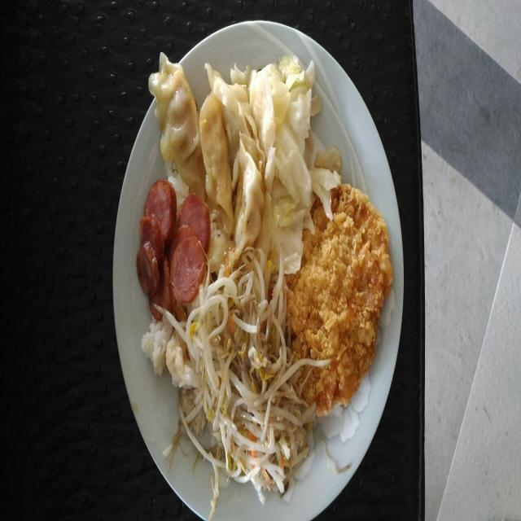
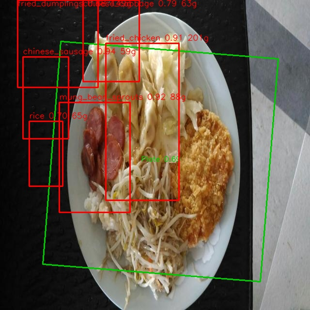

# 膳食识别系统（中餐）

> **中餐食物识别 + 重量估计 + 健康膳食建议**
> 技术路线：**YOLOv11 检测（盘子 OBB + 18 类中餐食物 bbox）→ 盘子/餐具参考尺度 → 面积估重 → 密度/营养换算 → BMR/TDEE → Ollama 流式建议**
>
> 思路源自 [DidntRead/food_calories](https://github.com/DidntRead/food_calories)，重构为可维护的工程，
> 并在检测模型上做了 **CBAM 注意力 + WIoU 损失** 的改进与消融实验。

## 项目亮点

| 项 | 内容 |
|---|---|
| **自训练中餐模型** | YOLOv11s，18 类常见中式菜品，2495 张训练图 |
| **改进方案消融** | 基线 / +CBAM+WIoU / +CBAM-neck+WIoU 三组对比，test mAP50 最高 **76.13%** |
| **双入口** | PySide6 图形界面上位机 + 命令行，共用同一套检测/估重/建议流水线 |
| **零代码换模型** | 换权重只需覆盖 `.pt` + 在营养表加类别 key，业务代码 0 改动 |
| **工程完整性** | 6 组单元测试、SQLite 历史、CSV 导出、Ollama 降级兜底 |

## 效果展示

| 输入 | 识别结果 |
|---|---|
|  |  |

> 上图实测：`fried_chicken 0.91 / 201g`、`mung_bean_sprouts 0.92 / 88g`、
> `fried_dumplings 0.80 / 190g`、`chinese_sausage 0.84 / 59g`、`rice 0.70 / 65g`
>
> 更多样例见 **[test_samples/](test_samples/)**（含西式对照图与便当盒遮挡场景）。

---

## 1. 快速开始

两个入口：

| 入口 | 命令 | 适用 |
|---|---|---|
| **图形界面（上位机）** | 双击 `启动上位机.bat` 或 `py -3.10 上位机.py` | 演示、日常使用 |
| 命令行 | `py -3.10 main.py` | 批量跑图、单图快速验证 |

```bash
# 安装依赖
py -3.10 -m pip install -r requirements.txt

# 交互式运行
py -3.10 main.py

# 一次性传参
py -3.10 main.py --image test_samples/input/05_chinese_oval_plate.jpg \
    --age 25 --gender 男 --height 175 --weight 70 --activity 1

# 加 SAM 分割精修（重量更准，CPU 约 +55 秒/图）
py -3.10 main.py --image test_samples/input/05_chinese_oval_plate.jpg \
    --age 25 --gender 男 --height 175 --weight 70 --activity 1 --sam
```

实际运行输出：

```
================================
  膳食识别系统（命令行版）
================================

请输入食物图片路径: test_samples/input/05_chinese_oval_plate.jpg
...（输入个人信息）

正在识别食物...
  · 盘子已定位：置信度 0.91，直径约 201 px
  · 尺度：8.04 px/cm（来源：盘子）→ 盘子直径约 25.0 cm
━━━━━━━━━━━━━━━━━━━━━━━━━━━━
检测到以下食物：
序号  | 食物                  | 置信度  | 重量      | 热量
------------------------------------------------------------------
1     | fried_chicken（炸鸡） | 0.91    | ~201 g    | 528 kcal
2     | fried_dumplings（煎饺）| 0.80   | ~190 g    | 456 kcal
3     | mung_bean_sprouts（豆芽）| 0.92  | ~88 g     | 31 kcal
4     | chinese_sausage（香肠）| 0.84   | ~59 g     | 300 kcal
5     | rice（米饭）          | 0.70    | ~65 g     | 84 kcal
------------------------------------------------------------------
总重量: 603 g    总热量: 1399 kcal
━━━━━━━━━━━━━━━━━━━━━━━━━━━━
用户健康数据：
  BMR（基础代谢）: 1674 kcal/天
  TDEE（每日消耗）: 2302 kcal/天（活动量 1 轻度）
  本餐热量占比: 60.8% TDEE
  BMI: 22.9（正常）
━━━━━━━━━━━━━━━━━━━━━━━━━━━━
正在调用 Ollama 生成膳食建议...
（流式 Markdown 建议……）
```

---

## 2. 中餐检测模型与改进实验

### 2.1 数据集

| 项 | 值 |
|---|---|
| 类别数 | **18 类**中式菜品 |
| 训练集 | 2495 张 |
| 验证集 | 131 张 |
| 测试集 | 94 张 |
| 标注格式 | YOLO bbox |
| 配置文件 | `configs/chinese_food_18.yaml` |

**18 个类别**：
`carrot_eggs`（胡萝卜炒蛋）、`chicken_nuggets`（鸡块）、`chinese_cabbage`（白菜）、
`chinese_sausage`（中式香肠）、`curry`（咖喱）、`fried_chicken`（炸鸡）、`fried_dumplings`（煎饺）、
`fried_eggs`（炒蛋）、`mung_bean_sprouts`（绿豆芽）、`rice`（米饭）、`triangle_hash_brown`（三角薯饼）、
`water_spinach`（空心菜）、`pumpkin`（南瓜）、`sweet_potato`（红薯）、`fried_string_beans`（干煸豆角）、
`fried_chicken_legs`（炸鸡腿）、`fried_noodles`（炒面）、`loofah`（丝瓜）

### 2.2 改进方案

针对「**一盘多菜、菜品互相遮挡、相似外观**」的中餐场景，做了两组改进：

| 方案 | 改进内容 | 实现文件 |
|---|---|---|
| **A. CBAM + WIoU** | Backbone 的 C3k2 后插入 CBAM；CIoU 换 WIoU v3 | `models/cbam.py`、`models/wiou.py` |
| **B. CBAM-neck + WIoU** | Neck 的 P3/P4 特征后插入 CBAM；CIoU 换 WIoU v3 | `models/yolo11s-cbam-neck.yaml` |

**为什么是 CBAM 而不是 SE**：SE 只做通道注意力，中餐场景更重要的是**空间注意力**
（食物在盘中的位置、遮挡边界、盘子/桌面干扰抑制）。CBAM = 通道 + 空间双注意力，更对口。

**为什么加 WIoU**：CIoU 对所有质量的框一视同仁，WIoU 的动态非单调聚焦机制让模型
更关注「差一点就对」的样本，提升定位精度——而框准不准直接决定面积→重量→热量的准确性。

### 2.3 实验结果（test 集，18 类）

| 模型 | Precision | Recall | mAP@0.5 | mAP@0.5:0.95 | 训练耗时 |
|---|---|---|---|---|---|
| **基线**（yolo11s + CIoU） | 75.76% | 68.47% | 74.63% | **50.24%** | 4260s |
| + CBAM（backbone）+ WIoU | 73.29% | 67.02% | 70.54% | 45.92% | 5569s |
| **+ CBAM（neck）+ WIoU** ⭐ | 74.66% | **73.13%** | **76.13%** | 48.43% | 6221s |

**结论**：

1. **方案 B（Neck 端 CBAM）在 mAP@0.5 和 Recall 上均优于基线**：
   - mAP@0.5：**76.13% vs 74.63%（+1.50）**
   - Recall：**73.13% vs 68.47%（+4.66）** ← 漏检显著减少
2. **Recall 提升是本项目最关心的指标**：一盘多菜场景下，漏检一道菜比框得不够准影响更大
   （漏了就没有重量和热量，整餐营养统计直接失真）。
3. **方案 A（Backbone 端 CBAM）效果不佳**（mAP50 -4.09），推测是深层特征插入注意力后
   破坏了预训练权重的特征分布，且训练轮次不足以重新收敛。
4. **mAP@0.5:0.95 略降（-1.81）**，说明高 IoU 阈值下的定位精度略有牺牲，
   但对「面积→重量」的量级估算影响有限（重量误差本就 ±30%~50%）。
5. 业务侧交叉验证：**16 张 test 图菜品级命中率 86.0%（改进版）vs 66.7%（基线）**。

> 详细消融过程、CBAM/WIoU 代码位置与启用方法见 **[docs/模型改进详解.md](docs/模型改进详解.md)**。
> 完整训练曲线（results.png / PR 曲线 / 混淆矩阵）见 **[docs/training_results/](docs/training_results/)**，
> 原始评估 JSON 见 **[docs/metrics/](docs/metrics/)**。

### 2.4 权重文件

| 文件 | 用途 | 大小 | 是否入库 |
|---|---|---|---|
| `models/weights/chinese_food_cbam_neck.pt` | **默认部署**：方案 B（CBAM-neck + WIoU） | 19 MB | ✅ 已上传 |
| `models/weights/chinese_food.pt` | 基线（yolo11s + CIoU），用于对比 | 19 MB | ✅ 已上传 |
| `models/weights/yolo11m-obb-plate.pt` | 盘子 + 餐具 OBB 检测（4 类） | 41 MB | ✅ 已上传 |
| `yolo11s.pt` / `yolo11m.pt` / `yolo11n.pt` | COCO 预训练基础模型 | 5-39 MB | ❌ 首次运行自动下载 |

切换模型只需改 `config.yaml` 一行：

```yaml
paths:
  food_model: models/weights/chinese_food_cbam_neck.pt   # 换成 chinese_food.pt 即切回基线
```

---

## 3. 环境说明（本机实测）

| 项 | 值 |
|---|---|
| 解释器 | Python 3.10.11 |
| 关键依赖 | ultralytics 8.3.158 / torch 2.1.0 / torchvision 0.16.0 / opencv-python 4.11 / numpy 1.26.4 / segment-anything 1.0 / loguru / PySide6 |
| 训练设备 | NVIDIA GPU（Ultralytics 自动选择） |
| 推理设备 | CPU 可跑（`config.yaml: detection.device`） |
| Ollama | `http://localhost:11434`，默认 `qwen2.5:1.5b`，建议换 `qwen2.5:7b` |
| SAM（可选） | `sam_vit_h_4b8939.pth`（2.4 GB），需单独下载，见 §9 |

> 直接敲 `python` 可能指向别的解释器（无依赖），建议统一用 `py -3.10 main.py`。

---

## 4. 目录结构

```
膳食模型x/
├── 上位机.py                   # 图形界面入口（PySide6）
├── 启动上位机.bat              # 双击启动
├── main.py                     # 命令行入口
├── requirements.txt
├── config.yaml                 # 全局配置（模型路径 / rice_rule / height_levels / ollama）
├── README.md
├── app/                        # 上位机
│   ├── main_window.py          # 主窗口：三页签、拖拽上传、三线程
│   ├── analyzer.py             # 单图分析：检测 → 估重 → 营养 → 配额/结构
│   ├── detection_rules.py      # 米饭三级处理 + 食物高度档位
│   ├── diet_rules.py           # 餐次配额 + 结构评估 + 该加什么
│   ├── widgets.py              # 结构评估面板
│   ├── prompt.py               # 膳食建议 prompt
│   ├── render.py               # PIL 中文标签绘制
│   ├── user_store.py           # 用户档案（data/users.json）
│   └── theme.py                # QSS
├── models/
│   ├── cbam.py                 # CBAM 注意力模块
│   ├── wiou.py / wiou_patch.py # WIoU v1/v2/v3 损失
│   ├── yolo11s-cbam.yaml       # 方案A：Backbone C3k2 后加 CBAM
│   ├── yolo11s-cbam-neck.yaml  # 方案B：Neck P3/P4 后加 CBAM（默认部署）
│   ├── yolo11m-cbam.yaml       # m 规模的结构定义
│   └── weights/                # 权重（3 个已上传，见 §2.4）
├── data/
│   ├── food_reference.yaml     # 营养参考（=检测白名单）：能量/蛋白/脂肪/碳水/纤维/钠/微量元素
│   ├── dri_cn.yaml             # 中国居民 DRIs 2023 + 膳食指南 2022
│   ├── density_table.yaml      # 密度表（g/cm³）
│   ├── reference_sizes.yaml    # 参考物真实尺寸（叉/刀/勺/盘，cm）
│   ├── images/                 # 内部示例图
│   └── history.db              # SQLite 历史（首次运行自动创建）
├── src/
│   ├── detection/              # plate_detector / scale_calculator / food_detector / sam_segmenter
│   ├── weight_estimation/      # portion_estimator / nutrition_calculator
│   ├── health/                 # bmr_calculator（BMR/TDEE/BMI）
│   ├── llm/                    # ollama_client（流式+降级）/ prompt_builder
│   ├── database/               # db_manager（SQLite 历史 + 当日汇总 + CSV 导出）
│   └── utils/                  # config_loader / logger / image_utils / food_labels
├── configs/                    # 数据集 yaml（chinese_food_18.yaml 等）
├── tools/                      # 训练 / 评估 / 数据清洗 / GUI 冒烟测试（21 个脚本）
├── tests/                      # detection / weight / health / llm / diet_rules / e2e
├── test_samples/               # 测试实例图片
│   ├── input/                  #   模型测试原图（6 张）
│   ├── results/                #   识别结果可视化（3 张）
│   └── README.md               #   每张图的场景与识别明细
├── docs/
│   ├── 上位机说明.md            # 餐次配额、结构评估、米饭三级、营养数据来源
│   ├── 模型改进详解.md          # CBAM + WIoU：位置、原因、启用清单、消融实验
│   ├── training_results/       # 三组实验的曲线 + 混淆矩阵 + 超参
│   └── metrics/                # test 集评估 JSON
├── logs/                       # loguru 日志（不入库）
└── _upstream/food_calories/    # 原始项目副本（只读参考，不入库）
```

---

## 5. 核心算法

### 5.1 尺度（像素 → 厘米）

OBB 检测叉/刀/勺/盘，`OBB 最长边(px) ÷ 真实尺寸(cm)`，多参考物取**中位数**：

```
px_per_cm = median([fork/18.5, knife/21.0, spoon/17.0, plate/25.0])
```

优先用餐具（尺寸标准），只有盘子时按 25 cm 标准盘；完全没有参考物时退化为「画面宽 40 cm」并告警。

### 5.2 重量（bbox 面积 → 克）

```
整图 → YOLO 食物 bbox（盘子 OBB 只用来定尺度）
面积(cm²) = bbox 像素面积 / px_per_cm² × area_fill_factor(0.80)
体积(cm³) = 面积 × 高度（默认 3 cm，可按食物覆写）
重量(g)   = 体积 × 密度
```

> 曾试过「盘子 OBB 外扩 10% → 旋转裁剪摆正 → 再检测」，实测明显更差：
> 25 张 test 图框级召回 51.4%（全图 77.0%），精确 60.3%（全图 82.6%）。
> 该路径保留在 `plate.crop_for_detection`，默认 `false`。

三重保护，避免「一份菜 1 kg」这种离谱值：

| 约束 | 配置 | 作用 |
|---|---|---|
| bbox 填充率 | `area_fill_factor: 0.80` | bbox 是外接矩形，食物填不满（圆形食物 bbox 天然大约 27%） |
| 单份上限 | `max_weight_by_food` | 抑制误检大框 |
| 盘子面积约束 | `max_plate_fill_ratio: 0.85` | 所有食物面积之和 ≤ 盘子面积×0.85，超出按比例收缩 |

同类多框自动合并（一块鸡胸 + 一块鸡腿 → 一个 `fried_chicken`）。

### 5.3 米饭遮挡三级处理

中餐场景米饭常被菜品遮盖，检测框面积会严重偏小，因此：

1. **正常检测**：米饭 bbox 面积 / 总食物面积 ≥ 15% → 直接使用
2. **检测到但过小**（被遮挡）：按总食物面积 × `rice_hidden_ratio`（默认 0.33）估算
3. **完全未检测到**：不做处理（可能确实没有米饭）

### 5.4 SAM 分割精修（可选，`--sam`）

对每个食物 bbox 用 SAM 做框提示分割，用**掩膜像素数**代替 bbox 面积（`mask_fill_factor=0.95`）。
实测同一张图：bbox 方案 204g+153g → SAM 方案 119g+79g（掩膜剔除了方框里的空隙，更接近真实）。

CPU 上每张图约 **55-80 秒**（`vit_h` 编码 1024×1024 是瓶颈），因此默认关闭。

### 5.5 热量与健康

```
热量(kcal) = 重量 × kcal_per_100g / 100
BMR  = 10×体重 + 6.25×身高 - 5×年龄 + (男 +5 / 女 -161)   # Mifflin-St Jeor
TDEE = BMR × 活动系数(1.375 / 1.55 / 1.725 / 1.9)
本餐占比 = 热量 / TDEE
```

### 5.6 LLM 建议

`prompt_builder` 组装「个人信息 + BMR/TDEE/BMI + 食物清单 + 总重量热量 + 三大营养素 + TDEE 占比 +
餐次配额 + 结构评估」，要求输出 4 节 Markdown（营养评估 / 需求匹配 / 搭配建议 / 个性化建议），
`ollama_client` 走 `POST /api/generate` **流式**打印。

**降级兜底**：服务未启动 → 打印排查步骤；模型未拉取 → 提示 `ollama pull`；中途断流 → 保留已输出内容。
检测与营养结果始终可用。

**餐次配额 + 结构评估**：输入早餐/午餐/晚餐，按 DRI 餐次占比给出该餐合理热量区间，
并评估蛋白质 / 膳食纤维 / 蔬菜占比 / 主食占比，输出「该加什么」。详见 `docs/上位机说明.md`。

---

## 6. 配置说明（config.yaml）

| 配置项 | 默认 | 说明 |
|---|---|---|
| `paths.food_model` | `models/weights/chinese_food_cbam_neck.pt` | 部署模型（方案 B）；改 `chinese_food.pt` 切回基线 |
| `paths.plate_model` | `models/weights/yolo11m-obb-plate.pt` | 盘子 + 餐具 OBB |
| `detection.device` | `cpu` | 有 GPU 改 `cuda:0`（可同时 `half: true`） |
| `detection.conf_threshold` | `0.25` | 食物置信度；误检多就抬到 0.35-0.45 |
| `detection.filter_unknown_food` | `true` | 营养表白名单过滤 |
| `plate.crop_for_detection` | `false` | 是否先裁盘再检测；实测裁剪明显掉点 |
| `segmentation.enabled` | `false` | 是否默认启用 SAM（也可 `--sam`） |
| `weight_estimation.area_fill_factor` | `0.80` | bbox 填充率；估重偏高就降到 0.65 |
| `weight_estimation.default_height_cm` | `3.0` | 食物堆叠高度（汤菜 2.0，馒头/蛋糕 5-6） |
| `weight_estimation.max_plate_fill_ratio` | `0.85` | 食物面积 / 盘子面积上限 |
| `ollama.model` | `qwen2.5:1.5b` | 换 `qwen2.5:7b` 建议质量明显更好 |
| `database.enabled` | `true` | 是否写 SQLite 历史 |

---

## 7. 命令行参数

```
--image 路径/URL   --age 25   --gender 男   --height 175   --weight 70   --activity 1
--sam               启用 SAM 分割精修（更准、更慢）
--no-llm            跳过 Ollama，只输出检测与营养
--no-save           不保存标注图
--no-db             不写 SQLite 历史
--model / --host    覆盖 Ollama 模型/地址
--food-model / --plate-model   覆盖模型路径（试新权重用）
--verbose           输出 DEBUG 日志
```

返回码：`0` 成功、`2` 未识别到食物、`1` 参数/运行错误、`130` 手动中断。

---

## 8. 测试

```bash
py -3.10 tests/test_detection.py   # 盘子/尺度/食物检测/旋转裁剪/SAM checkpoint
py -3.10 tests/test_weight.py      # 密度/重量合理性/上限/盘子约束/尺度平方律/热量
py -3.10 tests/test_health.py      # BMR/TDEE/BMI/性别别名/非法输入
py -3.10 tests/test_llm.py         # Prompt 完整性/在线流式/离线降级/缺失模型
py -3.10 tests/test_diet_rules.py  # 餐次配额/结构评估/米饭三级
py -3.10 tests/test_e2e.py         # 端到端（含 LLM）
```

---

## 9. 已知限制

1. **中餐类别只有 18 类**，覆盖常见食堂菜品；未收录的菜会被漏检或误判成邻近类别。
   扩展方式：训练新模型 → 覆盖 `.pt` → 把类别 key 追加到 `food_reference.yaml` / `density_table.yaml`。
2. **重量是粗估**：bbox 面积 + 固定高度 + 密度表，误差通常 **±30%~50%**；汤汁、堆叠类菜品偏差更大，
   只适合「量级判断」，不适合精确记账。开 `--sam` 可明显改善（掩膜更贴轮廓）。
3. **遮挡**：一盘多菜互相压盖时，被压住的菜面积会被低估；米饭有专门的三级补偿规则，其他菜品没有。
4. **拍摄角度**：建议俯拍（90°）。45° 斜拍时盘子 OBB 变梯形，尺度与面积都会偏低。
5. **CPU 推理**：检测 1-4 s；SAM +55-80 s；Ollama 1.5b 生成 10-40 s。
6. **小模型建议质量有限**：`qwen2.5:1.5b` 偶有事实性错误，建议 `ollama pull qwen2.5:7b`。

---

## 10. 后续升级路线

| 目标 | 做法 | 代码改动 |
|---|---|---|
| 扩展中餐类别 | 补数据训练，覆盖 `.pt` + 两个 yaml 加 key | **0 行** |
| 进一步提升召回 | 试 CBAM-neck + Repulsion Loss（针对菜品遮挡） | 仅训练侧 |
| 更准重量 | 默认开 `segmentation.enabled: true`（SAM 掩膜），或接 Depth Anything v2 | 改配置 / 新增模块 |
| 多餐累积 | `db_manager` 已有当日汇总，加「今日总摄入 vs TDEE」视图 | 约 50 行 |
| 换大模型 | `ollama pull qwen2.5:7b` + 改配置 | 0 行 |

---

## 11. 常见问题

**Q：`ModuleNotFoundError: No module named 'ultralytics'`**
A：用错解释器了。装依赖和运行都统一用 `py -3.10`。

**Q：中文路径图片读不进来？**
A：已处理（`np.fromfile + cv2.imdecode`），支持 `.jpg/.jpeg/.png/.bmp/.webp/.tif/.tiff`。

**Q：没检测到盘子？**
A：照片最好带完整盘子或刀叉勺；否则退到整图检测 + 画面宽度假设，误差变大。

**Q：某些中餐菜识别不出来？**
A：当前模型 18 类，未收录的菜属于预期漏检。可参照 `tools/train_chinese.py` 自己扩类重训。

**Q：Ollama 说没有模型？**
A：`ollama pull qwen2.5:1.5b`，或把 `config.yaml` 的 `ollama.model` 改成 `ollama list` 里已有的。

**Q：只想看检测结果？**
A：加 `--no-llm`。

**Q：想跑 SAM 精修但提示找不到 checkpoint？**
A：SAM 权重 2.4 GB 未随仓库分发，请从
`https://dl.fbaipublicfiles.com/segment_anything/sam_vit_h_4b8939.pth` 下载后放到
`config.yaml: segmentation.sam_checkpoint` 指定的路径。

---

## 引用与致谢

- 原始思路：[DidntRead/food_calories](https://github.com/DidntRead/food_calories)（Sofia University 课程项目）
- 检测框架：[Ultralytics YOLOv11](https://github.com/ultralytics/ultralytics)
- 注意力机制：CBAM, *ECCV 2018*
- 损失函数：Wise-IoU, *arXiv 2023*
- 分割精修：Meta [Segment Anything](https://github.com/facebookresearch/segment-anything)
- 营养数据：中国居民膳食营养素参考摄入量（DRIs 2023）、中国居民膳食指南（2022）
