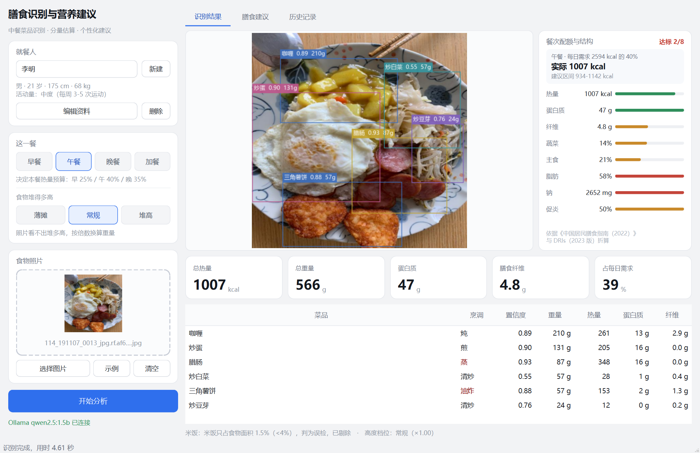
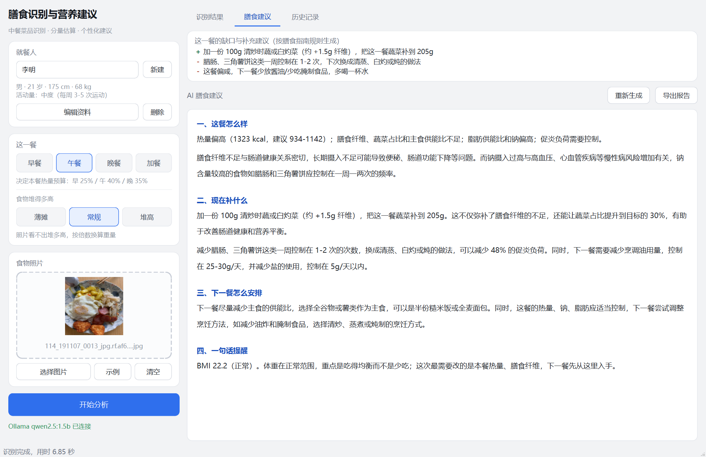
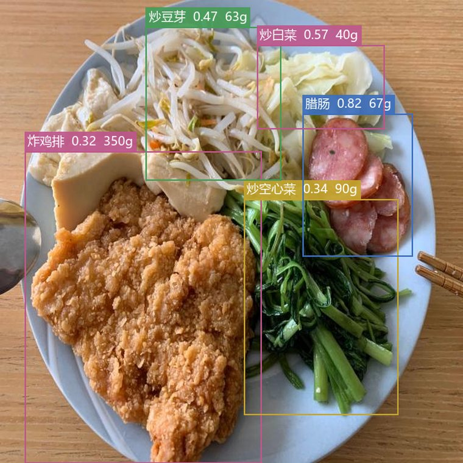
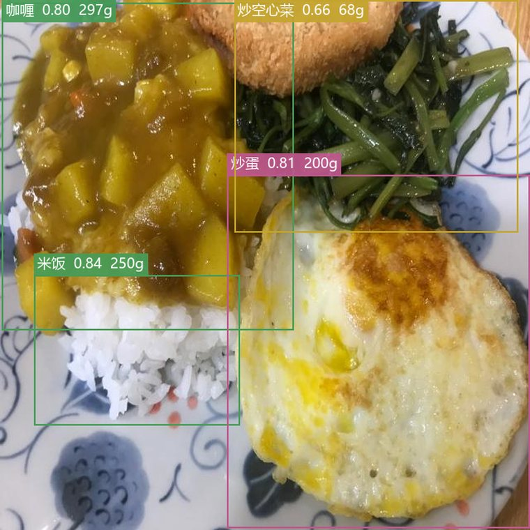
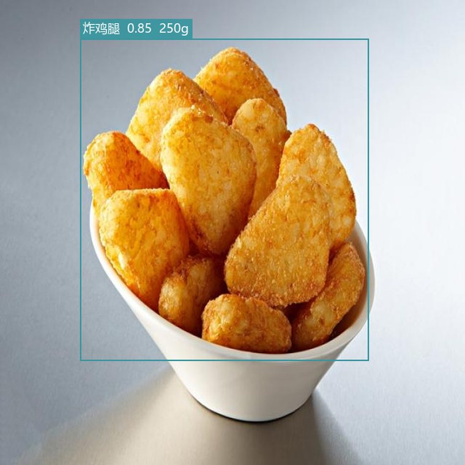
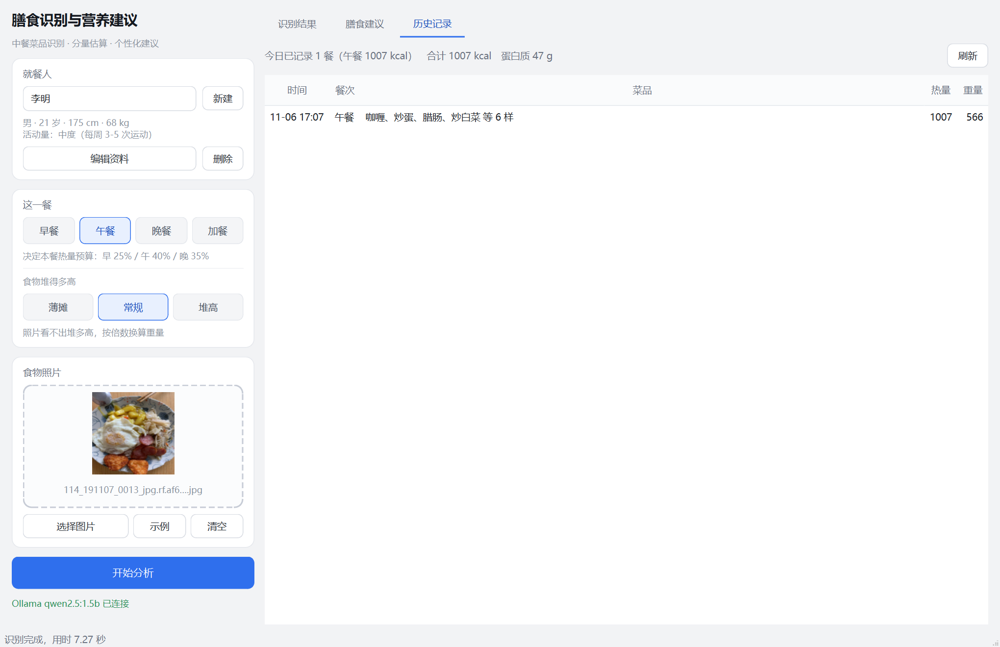
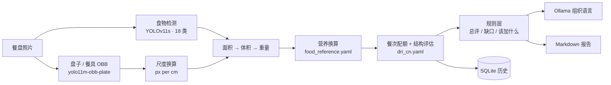

# 膳食识别系统 · Diet Food Recognition

<p align="center">
  <b>拍一张餐盘照片，算出这一餐吃了什么、大约多少克、多少热量，还差什么。</b><br/>
  中餐 18 类检测 · 面积估重 · 餐次配额 · 结构评估 · 本地大模型建议
</p>

<p align="center">
  
  
  
  
  
</p>

<p align="center">
  
</p>

---

## 目录

- [这是什么](#这是什么)
- [效果展示](#效果展示)
- [快速开始](#快速开始)
- [系统架构](#系统架构)
- [核心算法](#核心算法)
- [模型与改进实验](#模型与改进实验)
- [配置说明](#配置说明)
- [命令行用法](#命令行用法)
- [目录结构](#目录结构)
- [测试](#测试)
- [已知限制](#已知限制)
- [常见问题](#常见问题)

---

## 这是什么

一个**纯本地运行**的中餐膳食分析系统：输入一张俯拍的餐盘照片，输出这一餐的菜品清单、估算重量、
热量与营养素，并结合用户身体信息、餐次给出「这一餐怎么样、现在补什么、下一餐怎么安排」。

技术路线源自 [DidntRead/food_calories](https://github.com/DidntRead/food_calories)（西餐 + 参照物尺度），
本项目重构为可维护工程，并做了两件原项目没有的事：

1. **自训练 18 类中餐检测模型**，并在检测端做了 CBAM 注意力 + WIoU 损失的改进与消融实验；
2. **把「给建议」从大模型手里拿回来**——事实判断（偏低/偏高/该加多少）由规则层算死，
   大模型只负责组织语言。这是 1.5B 小模型能稳定输出的关键。

### 能做什么 / 不能做什么

| ✅ 能做 | ❌ 做不到 |
|---|---|
| 识别 18 类常见食堂/家常菜，输出置信度与估算重量 | 未收录的菜会漏检，或被判成外观相近的类别 |
| 按盘子/餐具换算像素尺度，估算单份重量（误差 ±30%~50%） | 精确到克的营养记账（汤汁、堆叠类偏差更大） |
| 按早/午/晚/加餐给本餐热量预算，评估 8 项结构指标 | 医学诊断、疾病饮食处方 |
| 指出「缺蛋白/缺蔬菜/钠超标/促炎负荷高」并给可执行的加法 | 判断食材是否新鲜、是否含过敏原 |
| 记录历史，按天汇总，导出 Markdown 报告 | 多日趋势建模与体重预测 |

---

## 效果展示

### 上位机：识别结果

左栏选就餐人与餐次（决定热量预算）、选择食物堆叠高度；中间是带框结果；右栏是结构评估 8 项进度条。

<p align="center">
  
</p>

这次识别出 6 样菜（咖喱 / 炒蛋 / 腊肠 / 三角薯饼 / 炒白菜 / 炒豆芽），合计 **1323 kcal、694 g**；
米饭只占食物面积 1.5%（<4%），被判为误检并剔除——这是中餐场景最常见的检测异常。

### 上位机：膳食建议

顶部灰色框是**规则层**生成的「该加 / 该减」清单，下面是本地大模型（qwen2.5:1.5b，纯 CPU）展开的四节建议。

<p align="center">
  
</p>

### 逐图识别效果

<table>
<tr>
<td width="33%"><br/><sub><b>5 菜全中</b>：方案C 5/5，基线 2/5</sub></td>
<td width="33%"><br/><sub><b>4 菜全中</b>：方案C 4/4，基线 2/4</sub></td>
<td width="33%"><br/><sub><b>典型错类</b>：薯饼特写被判成炸鸡腿（两个模型同错）</sub></td>
</tr>
</table>

### 上位机：历史记录

每次分析自动入库，按天汇总热量/蛋白/纤维，可切用户、可导出。

<p align="center">
  
</p>

更多原图与结果见 **[test_samples/](test_samples/)**。

---

## 快速开始

### 1. 环境

| 项 | 要求 |
|---|---|
| Python | 3.10（建议 `py -3.10`，避免 `python` 指向别的解释器） |
| 操作系统 | Windows（`启动上位机.bat`）/ macOS / Linux 均可，脚本按 Windows 写 |
| 磁盘 | 仓库含 3 个权重约 **143 MB** |
| GPU | 可选。有 CUDA 就把 `detection.device` 改成 `cuda:0`，CPU 单图约 4-7 秒 |
| Ollama | 可选。没有也能跑完检测 + 营养 + 规则结论，只是少一段自然语言建议 |

### 2. 安装

```bash
git clone https://github.com/FutureDC4/Diet-food-recognition.git
cd Diet-food-recognition

py -3.10 -m pip install -r requirements.txt
py -3.10 -m pip install PySide6-Essentials      # 只有上位机需要
```

> `torch 2.1.x` 必须配 `numpy<2`，否则会报 `_ARRAY_API not found`。`requirements.txt` 已锁好。

### 3. 启动上位机

```bash
py -3.10 上位机.py
# 或双击 启动上位机.bat
```

界面操作顺序：**选/建用户档案 → 选餐次 → 选食物高度 → 选图片（或直接拖进来）→ 开始分析**。

### 4. （可选）启动本地大模型

```bash
ollama pull qwen2.5:1.5b      # 约 1 GB，CPU 上 2-3 秒出 300 字
ollama serve
```

想要更好的文风，换 `qwen2.5:7b` 并改 `config.yaml → ollama.model`，代码不用动。

### 5. 命令行跑一张

```bash
py -3.10 main.py --image test_samples/input/05_chinese_oval_plate.jpg \
    --age 25 --gender 男 --height 175 --weight 70 --activity 1
```

---

## 系统架构



三层职责很清晰：

| 层 | 负责 | 文件 |
|---|---|---|
| **感知层** | 检测、尺度、面积、重量 | `src/detection/`、`src/weight_estimation/`、`app/analyzer.py` |
| **规则层** | 营养换算、餐次配额、结构判定、补什么 | `src/weight_estimation/nutrition_calculator.py`、`app/diet_rules.py`、`app/detection_rules.py` |
| **表达层** | 把结论写成自然语言 | `app/prompt.py` + `src/llm/ollama_client.py` |

> 关键设计：**表达层不许改判**。`diet_rules.build_summary()` 先写死一句总评，prompt 要求第一节原样引用。
> 原因很实际——实测 qwen2.5:1.5b 两次把「膳食纤维 6.2g / 目标 10g」写成「纤维达标」和「纤维偏高」。

---

## 核心算法

### 1. 尺度：像素 → 厘米

OBB 检测叉 / 刀 / 勺 / 盘，用 `最长边(px) ÷ 真实尺寸(cm)`，多参考物取中位数：

```
px_per_cm = median([fork/18.5, knife/21.0, spoon/17.0, plate/25.0])
```

优先用餐具（尺寸标准），只有盘子时按 25 cm 标准盘，完全没有参考物时退化为「画面宽 40 cm」并告警。

### 2. 重量：面积 → 克

```
面积(cm²) = bbox 像素面积 / px_per_cm² × area_fill_factor(0.80)
体积(cm³) = 面积 × 高度（默认 3 cm，可按食物覆写 / 用户选档位）
重量(g)   = 体积 × 密度
```

三重保护，避免「一份菜 1 kg」这种离谱值：

| 约束 | 配置 | 作用 |
|---|---|---|
| bbox 填充率 | `area_fill_factor: 0.80` | bbox 是外接矩形，圆形食物天然大约 27% |
| 单份上限 | `max_weight_by_food` | 按菜类设上限，抑制误检大框 |
| 盘子面积约束 | `max_plate_fill_ratio: 0.85` | 所有食物面积之和 ≤ 盘子面积 × 0.85，超出按比例收缩 |

### 3. 米饭三级处理

中餐米饭最容易被菜压住，检测框会严重偏小。按「米饭框面积 / 全部食物面积」分三级：

| 级别 | 条件 | 处理 |
|---|---|---|
| 一级 | ≥ 20% | 框够大，直接用检测值 |
| 二级 | 4% ~ 20% | 被遮挡，按「占食物总面积 1/3」反推（`R = O/2` 使米饭占 1/3） |
| 三级 | < 4% | 正常人不会只打这么一点饭，**判为误检直接剔除** |

二级反推另有 250 g 上限，防止其他菜的大框把米饭带飞。

### 4. 餐次配额 + 结构评估

按 DRIs 餐次占比给本餐预算（**不做归一化**，否则午餐 40% 会被压成 36%）：早 25% / 午 40% / 晚 35%，
加餐 10% 从午晚各匀 5%。

以 65 kg 男性、TDEE 2556 kcal 为例，午餐预算 **1022 kcal（区间 920-1124）**、
蛋白质 26 g、纤维 10 g、蔬菜 160 g、钠 ≤ 667 mg。

然后在 8 项上逐条判定，界面用进度条展示，悬停可看解释：

`热量` · `蛋白质` · `膳食纤维` · `蔬菜占比` · `主食供能比` · `脂肪供能比` · `钠` · `促炎负荷`

### 5. 建议怎么生成

| 步骤 | 谁做 | 产出 |
|---|---|---|
| ① 算 | 规则层 | 总评一句话、缺口清单、「加 100g 清炒时蔬 / 减 80g 米饭」这类可执行条目 |
| ② 写 | Ollama | 四节建议：这餐怎么样 / 现在补什么 / 下一餐怎么安排 / 一句话提醒 |
| ③ 兜底 | — | Ollama 未启动时，①②的全部结论照常显示，只少自然语言段落 |

营养数据来源：**中国食物成分表（第 6 版）** + **中国居民膳食营养素参考摄入量（DRIs 2023）** +
**中国居民膳食指南（2022）**，逐项写在 `data/food_reference.yaml` 与 `data/dri_cn.yaml` 的注释里。
碘和维生素 D 标了 `tracked: false`——菜品成分表估不出来，不参与缺口判断，免得把正常现象报成问题。

> 完整规则说明（阈值、公式、参数索引）见 **[docs/上位机说明.md](docs/上位机说明.md)**。

---

## 模型与改进实验

### 数据集

| 项 | 值 |
|---|---|
| 类别数 | **18 类**中式菜品 |
| 训练 / 验证 / 测试 | 2495 / 131 / 94 张 |
| 标注 | YOLO bbox，俯拍餐盘 |
| 配置 | `configs/chinese_food_18.yaml` |

`carrot_eggs`、`chicken_nuggets`、`chinese_cabbage`、`chinese_sausage`、`curry`、`fried_chicken`、
`fried_dumplings`、`fried_eggs`、`mung_bean_sprouts`、`rice`、`triangle_hash_brown`、`water_spinach`、
`pumpkin`、`sweet_potato`、`fried_string_beans`、`fried_chicken_legs`、`fried_noodles`、`loofah`

### 两组改进

| 方案 | 做法 | 文件 |
|---|---|---|
| **A**（失败） | Backbone 第 10 层 C2PSA 换成 CBAM + CIoU 换 WIoU v3 | `models/yolo11s-cbam.yaml` |
| **C**（采用） | 保持 0-22 层与原生完全一致，Neck 的 P3/P4 输出后各加一个 CBAM（reduction 8），Detect 前融合；仍用 WIoU v3 | `models/yolo11s-cbam-neck.yaml` |

**为什么是 CBAM 而不是 SE**：中餐场景的核心难点是空间维度——菜在盘里的位置、互相遮挡的边界、
盘子边缘与桌面的干扰。SE 只有通道注意力，CBAM = 通道 + 空间，更对口。

**为什么加 WIoU**：CIoU 对所有质量的框一视同仁，WIoU 的动态非单调聚焦让模型更关注「差一点就对」的样本。
而框准不准直接决定面积 → 重量 → 热量，这条链路上定位误差会被放大。

**方案 A 为什么失败**：在深层特征插注意力会破坏 COCO 预训练的特征分布，加载预训练权重后
索引错位 / 通道数不匹配，且 150 轮不足以重新收敛（mAP50 掉 4.09）。

### 检测指标（test 集 94 张，同一数据划分 / 超参 / 评估脚本）

| 模型 | Precision | Recall | mAP@0.5 | mAP@0.5:0.95 | 训练耗时 |
|---|---|---|---|---|---|
| 基线（yolo11s + CIoU） | 75.76% | 68.47% | 74.63% | **50.24%** | 4260 s |
| + CBAM(backbone) + WIoU | 73.29% | 67.02% | 70.54% | 45.92% | 5569 s |
| **+ CBAM(neck) + WIoU** ⭐ | 74.66% | **73.13%** | **76.13%** | 48.43% | 6221 s |

**怎么读这张表**：

- 方案C 在 **mAP@0.5 +1.50、Recall +4.66**，召回提升是本项目最在意的——漏一道菜就没有重量和热量，整餐统计直接失真。
- **mAP@0.5:0.95 −1.81**，高 IoU 阈值下定位略逊，但重量误差本就是 ±30%~50%，量级估算不受影响。
- 需要说明：单 seed、test 仅 94 张，配对 t 检验下**未达统计显著**（新-基线 −0.49）。
  这是「趋势性改进 + 端到端业务验证」，不是「显著优于基线」的结论。

### 端到端业务验证（16 张 test 图，与上位机同一条链路）

| 指标 | 方案C | 基线 |
|---|---|---|
| 菜品级命中（这盘菜有没有被认出来） | **86.0%（49/57）** | 66.7%（38/57） |
| 框级召回（IoU≥0.5 且类别一致） | **71.4%** | 55.6% |
| 框级精确 | 88.2% | 89.7% |
| F1 | **78.9%** | 68.6% |

逐图明细（节选 10 张，多菜场景为主；完整 16 张的汇总见上表）：

| # | 图片 | 真值菜品 | 方案C 命中 | 基线 命中 | 本餐热量 | 结构达标 |
|---|---|---|---|---|---|---|
| 1 | `114_191107_0007` | 5 | **5/5** | 4/5 | 1197 kcal | 1/8 |
| 2 | `img_95` | 5 | 5/5 | 5/5 | 1185 kcal | 2/8 |
| 3 | `img_47` | 6 | **5/6** | 4/6 | 1082 kcal | 4/8 |
| 4 | `img_96` | 5 | **5/5** | 2/5 | 1352 kcal | 2/8 |
| 5 | `img_87` | 5 | 4/5 | 4/5 | 963 kcal | 4/8 |
| 6 | `img_143` | 4 | **4/4** | 2/4 | 1073 kcal | 4/8 |
| 7 | `img_60` | 4 | 4/4 | 4/4 | 1358 kcal | 1/8 |
| 8 | `s2_images-10` | 1 | 1/1 | 1/1 | 100 kcal | 3/8 |
| 9 | `s2_sweet-potato` | 1 | 1/1 | 1/1 | 360 kcal | 2/8 |
| 10 | `triangle_hash_brown_8` | 1 | 0/1 | 0/1 | 600 kcal | 1/8 |
| | **合计** | **37** | **34/37（91.9%）** | **27/37（73.0%）** | | |

两个模型共同的弱点：`carrot_eggs` 在多张图里全漏；`triangle_hash_brown` 特写会被判成
`fried_chicken_legs`（置信度 0.85，两个模型同错）——属于训练集里这类样本过于单一。

### 权重文件

| 文件 | 用途 | 大小 |
|---|---|---|
| `models/weights/chinese_food_cbam_neck.pt` | **默认部署**：方案C（CBAM-neck + WIoU） | 19 MB |
| `models/weights/chinese_food.pt` | 基线（yolo11s + CIoU），对比用 | 19 MB |
| `models/weights/yolo11m-obb-plate.pt` | 盘子 + 餐具 OBB（4 类） | 41 MB |
| `yolo11n.pt` 等 COCO 基础模型 | 首次运行由 ultralytics 自动下载 | — |

切换只要改一行：

```yaml
paths:
  food_model: models/weights/chinese_food_cbam_neck.pt   # 换成 chinese_food.pt 即切回基线
```

> 消融全过程、CBAM/WIoU 代码位置、启用清单见 **[docs/模型改进详解.md](docs/模型改进详解.md)**。
> 训练曲线 / 混淆矩阵 / 超参在 **[docs/training_results/](docs/training_results/)**，
> 原始评估 JSON 在 **[docs/metrics/](docs/metrics/)**。

---

## 配置说明

全部集中在 `config.yaml`，改完重启生效，不用动代码。

| 配置项 | 默认 | 说明 |
|---|---|---|
| `paths.food_model` | `chinese_food_cbam_neck.pt` | 部署模型；换 `chinese_food.pt` 切回基线 |
| `paths.plate_model` | `yolo11m-obb-plate.pt` | 盘子 + 餐具 OBB |
| `detection.device` | `cuda:0` | 无 GPU 改 `cpu`（`half` 会自动忽略） |
| `detection.conf_threshold` | `0.25` | 误检多就抬到 0.35-0.45 |
| `detection.filter_unknown_food` | `true` | 用营养表白名单过滤非食物类别 |
| `plate.crop_for_detection` | `false` | 是否先裁盘再检测；实测裁剪明显掉点，见下 |
| `weight_estimation.area_fill_factor` | `0.80` | 估重偏高就降到 0.65 |
| `weight_estimation.default_height_cm` | `3.0` | 食物默认堆叠高度 |
| `rice_rule.trust_ratio / target_ratio / reject_ratio` | `0.20 / 0.3333 / 0.04` | 米饭三级阈值 |
| `height_levels` | 薄摊 0.75 / 常规 1.00 / 堆高 1.35 | 界面三档高度系数 |
| `ollama.model` | `qwen2.5:1.5b` | 换 7b 质量明显更好 |
| `ollama.num_gpu` | `0` | 0 = 纯 CPU；-1 = 交给 Ollama 决定（旧驱动在 GPU 上会报错） |
| `database.enabled` | `true` | 是否写 SQLite 历史 |

**关于 `crop_for_detection`**：曾试过「盘子 OBB 外扩 → 旋转裁剪摆正 → 再检测」，
25 张 test 图对比后放弃：

| 路径 | 框级召回 | 精确 | 命中框面积/真值 |
|---|---|---|---|
| 盘内旋转裁剪 | 51.4% | 60.3% | 1.38 |
| 整图检测 | **77.0%** | **82.6%** | 1.31 |

旋转后的裁剪图会让模型给出更大的框，盘边食物还会被切掉。现在盘子只负责换算 px/cm。

---

## 命令行用法

```bash
py -3.10 main.py                                    # 交互式
py -3.10 main.py --image 图片路径 --age 25 --gender 男 --height 175 --weight 70 --activity 1
```

| 参数 | 说明 |
|---|---|
| `--image` | 图片路径或 URL；不给则进入交互模式 |
| `--age --gender --height --weight --activity` | 身体信息，`activity` 取 1-4 |
| `--sam` | 对每个框跑 SAM，用掩膜面积代替 bbox（更准，CPU +55-80 s/图） |
| `--no-llm` | 跳过 Ollama，只输出检测与营养 |
| `--no-save / --no-db` | 不保存标注图 / 不写历史 |
| `--model / --host` | 覆盖 Ollama 模型与地址 |
| `--food-model / --plate-model` | 覆盖权重路径（试新模型用） |
| `--verbose` | DEBUG 日志 |

返回码：`0` 成功、`2` 未识别到食物、`1` 参数或运行错误、`130` 手动中断。

---

## 目录结构

```
Diet-food-recognition/
├── 上位机.py                    # PySide6 图形界面入口
├── 启动上位机.bat               # 双击启动（Windows）
├── main.py                      # 命令行入口
├── config.yaml                  # 全局配置
├── requirements.txt
├── app/                         # 上位机
│   ├── main_window.py           #   主窗口：三页签、拖拽上传、三线程（检测/绘图/LLM）
│   ├── analyzer.py              #   单图分析：检测 → 估重 → 营养 → 配额/结构
│   ├── detection_rules.py       #   米饭三级 + 高度档位
│   ├── diet_rules.py            #   餐次配额 + 结构评估 + 该加什么
│   ├── widgets.py               #   结构评估面板与指标卡
│   ├── prompt.py                #   建议 prompt（含结论锁定）
│   ├── render.py                #   PIL 中文标签绘制
│   ├── user_store.py            #   用户档案（data/users.json）
│   └── theme.py                 #   QSS
├── models/
│   ├── cbam.py                  # CBAM 注意力（通道 + 空间）
│   ├── wiou.py / wiou_patch.py  # WIoU v1/v2/v3（猴补丁替换 BboxLoss）
│   ├── yolo11s-cbam-neck.yaml   # 方案C 结构（默认部署）
│   ├── yolo11s-cbam.yaml        # 方案A 结构
│   └── weights/                 # 3 个权重，见上文
├── data/
│   ├── food_reference.yaml      # 营养表（= 检测白名单）：能量/P/F/C/纤维/钠/微量元素/烹调/促炎
│   ├── dri_cn.yaml              # DRIs 2023 + 膳食指南 2022
│   ├── density_table.yaml       # 密度表（g/cm³）
│   ├── reference_sizes.yaml     # 参考物真实尺寸（cm）
│   └── history.db               # SQLite 历史（首次运行创建）
├── src/
│   ├── detection/               # plate_detector / food_detector / scale_calculator / sam_segmenter
│   ├── weight_estimation/       # portion_estimator / nutrition_calculator
│   ├── health/                  # bmr_calculator（BMR / TDEE / BMI）
│   ├── llm/                     # ollama_client（流式 + 降级）
│   ├── database/                # db_manager（历史 + 当日汇总 + CSV 导出）
│   └── utils/                   # config_loader / image_utils / logger / food_labels
├── configs/                     # 数据集 yaml
├── tools/                       # 训练 / 评估 / 数据清洗 / 批量测试 / 界面冒烟（19 个脚本）
├── tests/                       # detection / weight / health / llm / diet_rules / e2e
├── test_samples/                # 示例图片与识别结果
├── docs/
│   ├── 上位机说明.md             # 配额、结构评估、米饭三级、营养来源
│   ├── 模型改进详解.md           # CBAM + WIoU：位置、原因、消融
│   ├── training_results/        # 三组实验曲线 + 混淆矩阵 + 超参
│   ├── metrics/                 # test 集评估 JSON
│   └── screenshots/             # README 用截图
└── logs/                        # loguru 日志（不入库）
```

---

## 测试

```bash
py -3.10 tests/test_detection.py    # 盘子 / 尺度 / 食物检测 / 旋转裁剪映射
py -3.10 tests/test_weight.py       # 密度 / 重量合理性 / 上限 / 盘子约束
py -3.10 tests/test_health.py       # BMR / TDEE / BMI / 非法输入
py -3.10 tests/test_llm.py          # Prompt 完整性 / 在线流式 / 离线降级
py -3.10 tests/test_diet_rules.py   # 餐次配额 / 结构评估 / 米饭三级 / 总评自洽
py -3.10 tests/test_e2e.py          # 端到端（含 LLM）

py -3.10 tools/gui_smoke_test.py    # 界面冒烟测试，自动截图到 runs/gui/
```

批量对比两个权重（走上位机同一条链路，输出 HTML 报告）：

```bash
py -3.10 tools/test_plan_c.py --count 16
# → runs/plan_c_test/report.html，含逐图预测/真值/命中/热量/达标项
```

---

## 已知限制

1. **只有 18 类**，覆盖常见食堂菜品；未收录的菜会漏检或被判成相近类别。
   扩展方式：训练新模型 → 覆盖 `.pt` → 两个 yaml 补类别 key，业务代码 0 改动。
2. **重量是粗估**：bbox 面积 + 高度 + 密度表，误差通常 ±30%~50%，只适合量级判断。
   开 `--sam` 或改用分割模型能明显改善。
3. **遮挡**：一盘多菜互相压盖时被压住的面积会低估；米饭有三级补偿，其他菜没有。
4. **拍摄角度**：建议俯拍（90°）。45° 斜拍时盘子 OBB 变梯形，尺度和面积都会偏低。
5. **速度**：CPU 检测 4-7 s、Ollama 1.5B 生成 10-40 s；GPU 下检测约 1 s。
6. **小模型建议质量**：`qwen2.5:1.5b` 仍偶有措辞偏差，建议 `ollama pull qwen2.5:7b`。

---

## 常见问题

**Q：`ModuleNotFoundError: No module named 'ultralytics'`**
装依赖和运行要用同一个解释器，统一 `py -3.10`。

**Q：中文路径的图片读不进来？**
已处理（`np.fromfile` + `cv2.imdecode`），支持 jpg/jpeg/png/bmp/webp/tif。

**Q：没检测到盘子？**
不影响主体流程，尺度会退化到「画面宽 40 cm」，误差变大。建议照片里带上完整盘边或餐具。

**Q：某些菜识别不出来？**
当前 18 类，未收录属于预期漏检。`tools/train_chinese.py` 可扩类重训。

**Q：Ollama 报没有模型？**
`ollama pull qwen2.5:1.5b`，或把 `ollama.model` 改成 `ollama list` 里已有的。

**Q：Ollama 在 GPU 上报 `CUDA error: device kernel image is invalid`？**
驱动太旧。先按默认 `num_gpu: 0` 走 CPU（1.5B 约 2-3 秒），升级驱动后改回 `-1`。

**Q：想跑 SAM 但提示找不到 checkpoint？**
SAM 权重 2.4 GB 未随仓库分发，从
[官方地址](https://dl.fbaipublicfiles.com/segment_anything/sam_vit_h_4b8939.pth)
下载后放到 `config.yaml → segmentation.sam_checkpoint`。

**Q：数据集在哪？**
未随仓库分发（体积大）。`configs/chinese_food_18.yaml` 里的 `path` 需改成本机路径，
数据按 `train/valid/test` + `images/labels` 结构放置即可。

---

## 致谢

- 原始思路：[DidntRead/food_calories](https://github.com/DidntRead/food_calories)
- 检测框架：[Ultralytics YOLOv11](https://github.com/ultralytics/ultralytics)
- 注意力机制：[CBAM, ECCV 2018](https://arxiv.org/abs/1807.06521)
- 损失函数：[Wise-IoU, arXiv 2023](https://arxiv.org/abs/2301.10051)
- 分割精修：[Segment Anything](https://github.com/facebookresearch/segment-anything)
- 营养数据：[中国食物成分表 第6版](https://www.chinanutri.cn/)、DRIs 2023、中国居民膳食指南（2022）
- 本地推理：[Ollama](https://ollama.com/)
